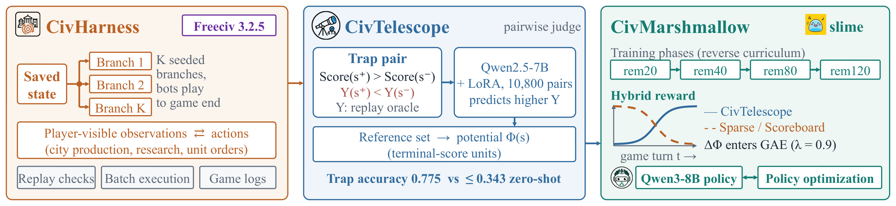

# Rome Wasn't Built in One Turn: Replay-Grounded Reward Signals for Long-Horizon Freeciv Agents

Language-model agents that play long strategy games get little feedback: the outcome arrives at the end of the
game, and the in-game score that arrives every turn often points the wrong way. This repository measures that
gap by replaying saved games, and trains agents around it:

- **CivHarness**: a save / branch / replay harness for Freeciv, Othello and Catan that turns any saved
  position into measured long-horizon outcomes.
- **CivTelescope**: a pairwise value model trained on those replayed outcomes.
- **CivMarshmallow**: an RL recipe that uses CivTelescope as a dense, per-decision reward.



## Highlights

- **Scoreboard traps, measured.** Across eight strategy games, the position with the higher in-game score
  often leads to the worse outcome. Every label comes from replaying the position to the end of the game, not
  from a heuristic.
- **Deterministic Freeciv at scale.** Replay from a mid-game save is byte-identical. Branches are re-seeded,
  and every measured effect comes with its noise floor. Agents act through a real network client and see only
  what their player sees.
- **A value model that looks past the score.** CivTelescope learns from replayed outcomes on pairs that
  include scoreboard traps, and is evaluated against zero-shot language models on new game starts, later
  turns and an unseen ruleset.
- **Dense rewards for long-horizon RL.** CivTelescope becomes a potential in final-score units through a
  reference set that refreshes from the policy's own games. Hybrid rewards start from the scoreboard or the
  final score and shift to CivTelescope as the game advances.
- **Not tied to Freeciv.** Othello and Catan run under the same save / branch / replay contract, and the whole
  pipeline (bank, CivTelescope, reference set, RL) runs on them as well.

## Features

| Component | What it provides |
|---|---|
| `civharness` | freeciv-server 3.2.5 lifecycle, batch runs, `snapshot_series` / `branch` / `noise_floor`; a network client for city production, research, rates, diplomacy and unit actions; a single- and multi-agent driver; `EnvSpec` limits on observations and actions; player-visible fog of war; a scene-graph observation and legal-action candidates; episode logs with byte-exact replay |
| `civharness.games` | Othello and Catan in-process with the same verbs: position libraries, a replay oracle, external control of one seat |
| `civmarsh.oracle`, `civmarsh.traps` | replay-labelled position banks for Freeciv and seven other games (chess, Othello, backgammon, Go 9×9, Hearts, 2048, Catan); trap rates by game progress, game-length curves, same-start traps |
| `civmarsh.civtelescope` | fog-of-war rendering, trap-aware pair building, LoRA training, merging, evaluation, zero-shot language-model baselines, a regression value head, input ablations |
| `civmarsh.rewards`, `civmarsh.train` | slime integration; sparse, scoreboard, CivTelescope, hybrid, terminal-only and value-head rewards; reference sets with refresh; per-decision GAE; a four-phase curriculum launcher |
| `civmarsh.eval`, `civmarsh.baselines` | phase-gain evaluation with paired statistics, prompting-scaffold baselines, offline diagnostics of the value signals |

## Quick start

From the repository root, with [uv](https://docs.astral.sh/uv/):

```bash
uv sync --extra civtelescope --extra games
```

A small Othello bank (engine games, snapshots, replay-oracle labels) and its scoreboard-trap rate, overall and
by game progress, on a CPU in under a minute:

```bash
uv run python scripts/build_game_bank.py --game othello --n-games 6 --replays 4 --out results/othello_bank.jsonl
uv run python scripts/cross_game_trap_rates.py --bank othello=results/othello_bank.jsonl \
    --min-bin-pairs 1 --out results/othello_trap_rates.json
```

For Freeciv, build the pinned server and run the harness acceptance suite:

```bash
bash scripts/install_freeciv_server.sh
export CIVHARNESS_SERVER=$HOME/opt/freeciv-3.2.5/bin/freeciv-server
uv run pytest tests/civharness
```

## Documentation

| Page | Content |
|---|---|
| [Installation](docs/installation.md) | server, Python package (uv or pip), slime, environment variables, hardware |
| [CivHarness](docs/civharness.md) | save / branch / replay, external control, agents, environment specs, episode replay |
| [Scoreboard traps](docs/scoreboard-traps.md) | position banks and trap rates in Freeciv and other games |
| [CivTelescope](docs/civtelescope.md) | training data, training, evaluation, baselines, ruleset transfer, ablations |
| [Training](docs/training.md) | rewards, phases, start banks and reference sets, RL training, evaluation, baselines |
| [Other games](docs/other-games.md) | the full pipeline on Othello and Catan |
| [Repository layout](docs/README.md#repository-layout) | where each part of the code lives |

## Released models

The [CivMarshmallow collection](https://huggingface.co/collections/CivMarshmallow/civmarshmallow) on Hugging Face:

- [`CivMarshmallow/CivTelescope`](https://huggingface.co/CivMarshmallow/CivTelescope): the CivTelescope LoRA
  adapter for Qwen2.5-7B-Instruct (merge with `scripts/merge_lora.py`).
- [`CivMarshmallow/CivMarshmallow-Qwen3-8B`](https://huggingface.co/CivMarshmallow/CivMarshmallow-Qwen3-8B):
  policies trained with CivTelescope and hybrid rewards.
- [`CivMarshmallow/Baselines-Qwen3-8B`](https://huggingface.co/CivMarshmallow/Baselines-Qwen3-8B): policies
  trained with the sparse and scoreboard rewards.

## License

Apache-2.0.
